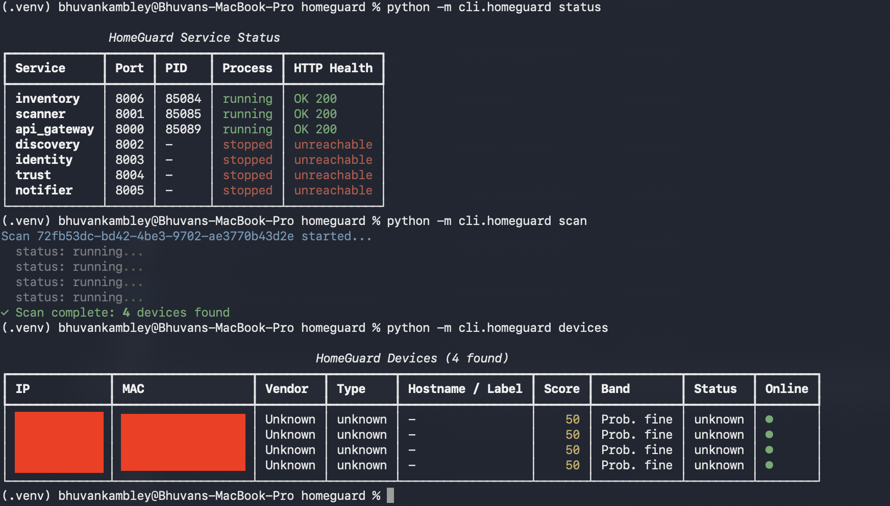
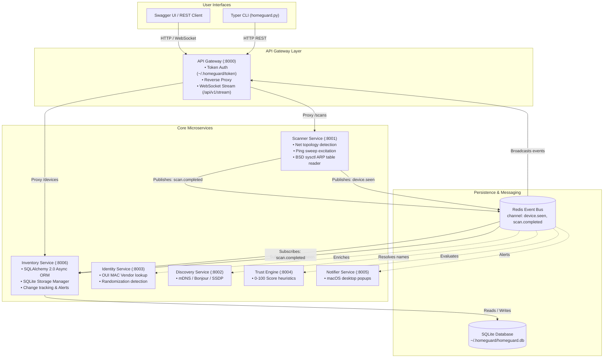
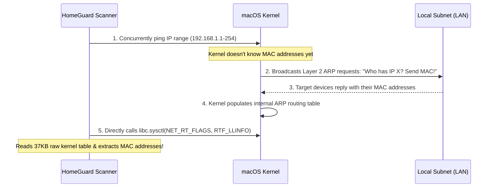

# 🛡️ Sentry / HomeGuard

> **A local-first, privacy-respecting Wi-Fi security daemon and device inventory system built specifically for macOS.**

---

## 📌 Project Intention & Purpose

Most home networks are black boxes. At any given moment, 15 to 30+ devices (smartphones, laptops, smart TVs, IoT bulbs, streaming sticks, guests) are connected to your home Wi-Fi. 

Traditional tools fall short for security monitoring:
* **Router Admin Panels (`192.168.1.1`)**: Clunky, password-protected, brand-dependent, and only show who is currently active—never who joined while you were asleep or away.
* **Point-in-Time Scanners (`nmap`, `arp -a`)**: Static snapshots with zero memory. Once the terminal closes, the state is lost.
* **Commercial Apps (Fing, Netgear/TP-Link mobile apps)**: Often closed-source, require subscriptions for basic alerts, and **upload your private home device names and MAC addresses to cloud servers**.

### What HomeGuard Does Differently:
1. **Persistent Historical Inventory**: Remembers every device ever seen, tracking `first_seen`, `last_seen`, and every sighting in an atomic local SQLite database.
2. **Instant Change Detection**: The `homeguard changes` command instantly answers: *"What new device joined my network since my last session?"*
3. **100% Local-First & Private**: Binds strictly to `127.0.0.1` (localhost). Zero cloud dependencies, zero external telemetry, zero subscriptions.
4. **Explainable Trust Scoring (0–100)**: Evaluates whether a device uses randomized MAC addresses, has suspicious open ports, or joins at anomalous times.
5. **Native macOS Integration**: Built specifically for macOS, interrogating the Darwin kernel directly via BSD `sysctl` without requiring Docker or root privileges.

---

## 🖼️ Screenshots & Live Working Demos

<!-- 
Drop your screenshots into a `screenshots/` folder inside the sentry directory. 
The image links below will automatically render your screenshots on GitHub or IDE preview.
-->

### 1. Service Status & Health Monitoring
_Verifying all event-driven microservices are healthy on localhost._



<!-- ---

### 2. Live Subnet Discovery Scan
_Sweeping the local /24 subnet and resolving physical hardware MAC addresses._


---

### 3. Discovered Devices Inventory
_Displaying active hosts, MAC addresses, trust bands, and online status indicators._


--- -->

<!-- ### 4. Network Change Log (`homeguard changes`)
_Highlighting new devices that joined the network since the last session._


--- -->


---

## 🏗️ System Architecture

HomeGuard uses an **event-driven microservices architecture** orchestrated via a **Redis Pub/Sub Event Bus**:



---

## ⚙️ How It Works: The Core Logic

### 1. The Challenge: IP vs. MAC Address
* On home Wi-Fi, IP addresses are volatile. Your iPhone may be `192.168.1.42` today and `192.168.1.55` tomorrow due to DHCP renewal.
* A security tool cannot track devices by IP. It must identify physical **MAC addresses** (`3E:59:8A:06:B4:72`).
* To map an IP to a MAC, the operating system uses **ARP (Address Resolution Protocol)** at Layer 2 (Data Link Layer).

### 2. How Device Discovery Works on macOS (Without Root / Sudo)
On modern macOS versions (Sonoma & Sequoia), Apple restricts third-party Python programs from invoking `/usr/sbin/arp`. If a normal process calls `arp -a`, macOS returns an empty string to protect user privacy.

HomeGuard overcomes this natively through a 2-step mechanism:



1. **Ping Sweep Excitation**: The scanner launches a lightweight, concurrent ping sweep across the subnet (`192.168.1.1` to `192.168.1.254`). Even if a target has a stealth firewall blocking ICMP, the kernel **must** send an ARP request before it can emit the ping packet.
2. **Native BSD `sysctl` Table Extraction**: Instead of spawning CLI commands, HomeGuard loads `/usr/lib/libc.dylib` via Python's `ctypes` and calls `libc.sysctl(NET_RT_FLAGS, RTF_LLINFO)`. This reads the kernel's ARP table directly into memory, extracting IP-to-MAC mappings natively without needing `sudo`.
3. *(Privileged Mode)*: If started with `sudo`, HomeGuard uses **Scapy** to open `/dev/bpf*` directly and conduct raw Layer 2 ARP sweeps.

### 3. The Event-Driven Pipeline
1. For every active host found, the Scanner emits a `DeviceSeenEvent` to Redis topic `device.seen`.
2. The **Inventory Service** listens to `device.seen`:
   * **Known Device**: Updates `last_seen` timestamp and appends a sighting record.
   * **New Device**: Inserts a new record into SQLite, flags status as `new`, and publishes an `alert.created` event.
3. When the sweep finishes, `scan.completed` is emitted, updating the scan status and duration in the database.
4. The CLI or Web UI streams live progress via WebSockets or displays formatted Rich tables.

---

## 💻 Tech Stack & Dependencies

| Component | Technology | Rationale & Purpose |
| :--- | :--- | :--- |
| **Language** | **Python 3.11+ / 3.14** | Fast development, extensive networking and async libraries. |
| **API Framework** | **FastAPI** | High-performance async REST endpoints, automatic OpenAPI (Swagger) documentation, and native WebSocket support. |
| **ASGI Server** | **Uvicorn** | Lightning-fast async server implementation for ASGI applications. |
| **Database & ORM** | **SQLite + SQLAlchemy 2.0 (AsyncIO)** | Zero-configuration, local file storage (`aiosqlite`) with fully asynchronous ORM queries. |
| **Event Bus** | **Redis (`redis-py`)** | Sub-millisecond pub/sub decoupling microservices from direct HTTP inter-dependencies. |
| **Low-Level Networking** | **macOS `libc.sysctl` + `ctypes`** | Reads kernel ARP tables directly, bypassing macOS sandbox CLI execution restrictions without root. |
| **Raw Packet Crafting** | **Scapy** | Privileged Layer 2 packet crafting and BPF sniffing when running with root. |
| **Data Validation** | **Pydantic v2 + Pydantic-Settings** | Strict data typing, schema serialization, and `.env` configuration management. |
| **CLI & Terminal UI** | **Typer + Rich** | Beautiful terminal dashboard with color-coded trust bands, tables, and progress indicators. |
| **Test Suite** | **Pytest + Pytest-AsyncIO** | Comprehensive unit and integration testing of async endpoints, schemas, and database repositories. |

---

## 📂 File & Directory Structure

```text
sentry/
├── README.md                      # Primary project documentation (this file)
├── screenshots/                   # Working demo screenshots
│   ├── status.png
│   ├── scan.png
│   ├── devices.png
│   ├── changes.png
│   └── swagger_docs.png
└── homeguard/                     # Main application package
    ├── pyproject.toml             # Build system, dependencies, and metadata
    ├── pyrightconfig.json         # Python language server path resolution
    ├── .env.example               # Template environment configuration
    │
    ├── libs/                      # Shared libraries across all microservices
    │   └── common/
    │       ├── bus.py             # Async Redis EventBus wrapper (pub/sub)
    │       ├── config.py          # Pydantic Settings & environment loader
    │       ├── events.py          # Redis topic names & event payload models
    │       ├── logging.py         # Structured JSON logging formatter
    │       └── schemas.py         # Shared DTOs (DeviceResponse, Alert, Scan)
    │
    ├── services/                  # Microservices layer
    │   ├── api_gateway/           # Port 8000: Reverse proxy, auth, WebSockets
    │   │   ├── auth.py            # Local bearer token manager (~/.homeguard/token)
    │   │   └── main.py            # Routes, aggregated health checks, WS stream
    │   │
    │   ├── scanner/               # Port 8001: Network discovery engine
    │   │   ├── arp.py             # BSD sysctl kernel reader & Scapy ARP engine
    │   │   ├── netinfo.py         # macOS interface, subnet, SSID detector
    │   │   └── main.py            # Scan coordinator & event publisher
    │   │
    │   ├── inventory/             # Port 8006: Database & storage manager
    │   │   ├── models.py          # SQLAlchemy 2.0 ORM models (Device, Alert, etc.)
    │   │   ├── repo.py            # Async DB repository (CRUD, upsert, diffs)
    │   │   └── main.py            # Inventory REST API & Redis subscriber
    │   │
    │   ├── identity/              # Port 8003: OUI MAC vendor lookup & fingerprinting
    │   ├── discovery/             # Port 8002: mDNS / Bonjour / SSDP resolution
    │   ├── trust/                 # Port 8004: Heuristic trust scoring engine
    │   └── notifier/              # Port 8005: macOS desktop notification dispatcher
    │
    ├── cli/                       # Terminal user interface
    │   └── homeguard.py           # Typer CLI (start, stop, status, scan, devices)
    │
    └── tests/                     # Automated test suite
        ├── test_inventory.py      # Async database CRUD and change detection tests
        └── test_schemas.py        # Schema validation and event serialization tests
```

---

## 🚀 Quickstart Guide

### 1. Prerequisites
* **macOS** (Sonoma, Sequoia, or newer supported)
* **Python 3.11+**
* **Redis** (via Homebrew):
  ```bash
  brew install redis
  brew services start redis
  ```

### 2. Installation
Clone the repository and install the project in editable mode within a virtual environment:

```bash
cd /Users/bhuvankambley/projects/sentry/homeguard

# Create and activate virtual environment
python3 -m venv .venv
source .venv/bin/activate

# Install dependencies and CLI
pip install -e ".[dev]"
```

### 3. Verify Tests
Run the test suite to ensure everything is configured properly:
```bash
python -m pytest tests/ -v
# Output: 11 passed in 0.20s
```

### 4. Start the Services
Start the background microservices (API Gateway, Scanner, Inventory):
```bash
python -m cli.homeguard start --no-sudo
```

Verify service status:
```bash
python -m cli.homeguard status
```

### 5. Run a Network Scan
Trigger an active discovery scan of your Wi-Fi:
```bash
python -m cli.homeguard scan
```

### 6. Inspect Results
* **View all discovered devices:**
  ```bash
  python -m cli.homeguard devices
  ```
* **View newly joined devices:**
  ```bash
  python -m cli.homeguard changes
  ```
* **Interactive API Dashboard:**  
  Open **[http://127.0.0.1:8000/docs](http://127.0.0.1:8000/docs)** in your browser and authorize using your local token:
  ```bash
  cat ~/.homeguard/token
  ```

---

## 🔒 Security & Privacy Principles

1. **Localhost Only**: Every service strictly binds to `127.0.0.1`. No external network interfaces are exposed.
2. **Zero Cloud Dependencies**: The system never communicates with any third-party server. All data stays in `~/.homeguard/homeguard.db`.
3. **Token Authentication**: All API Gateway routes are guarded by a high-entropy secret token generated at startup with restricted file permissions (`chmod 0600`).
4. **Passive-First Scanning**: Sweeps are lightweight and ethical, designed to minimize network congestion and avoid tripping router IDS firewalls.
